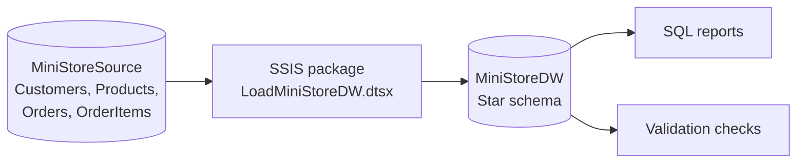
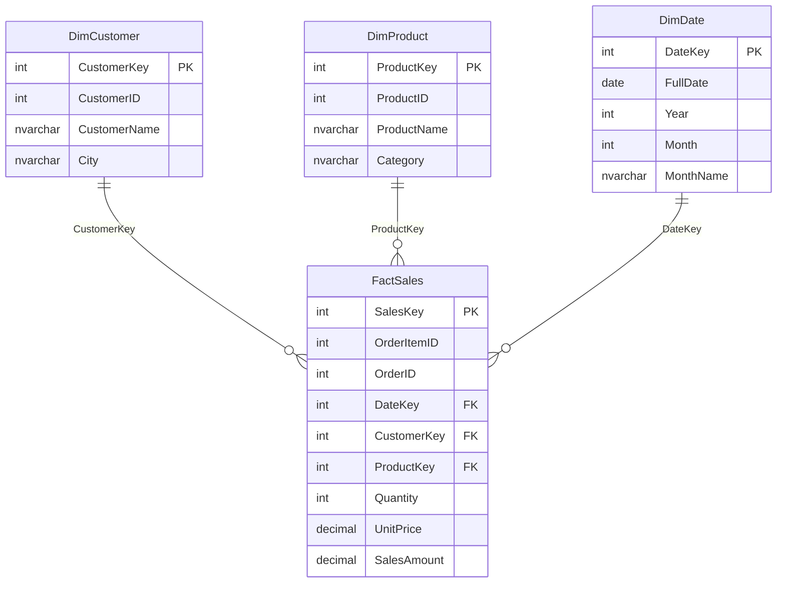
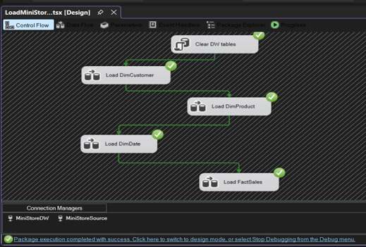
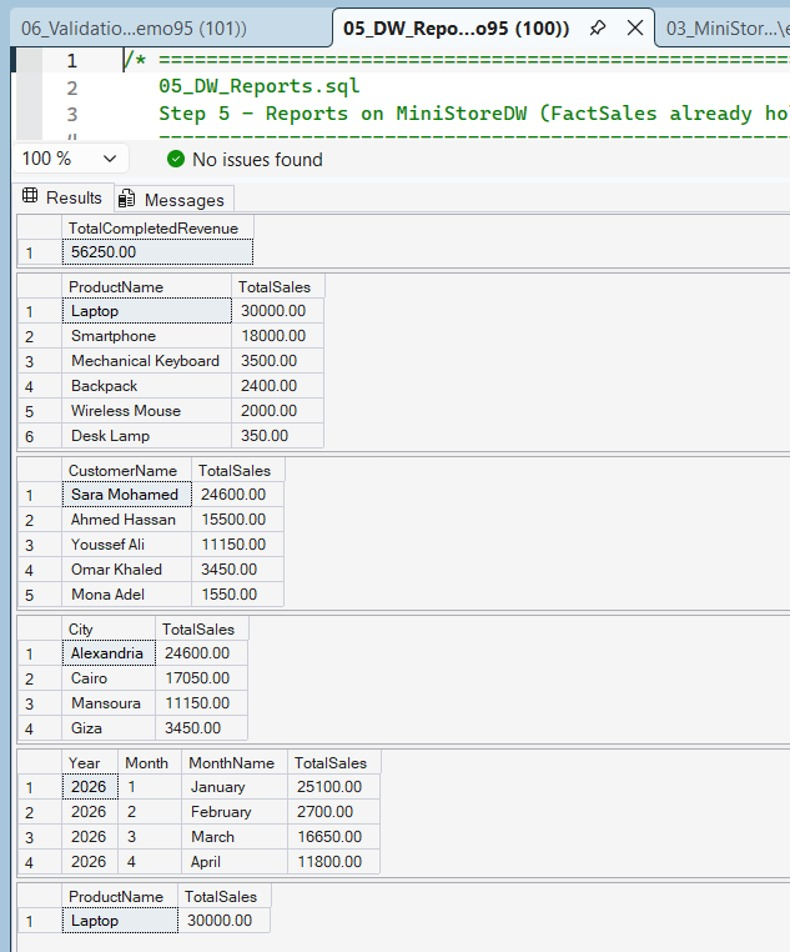
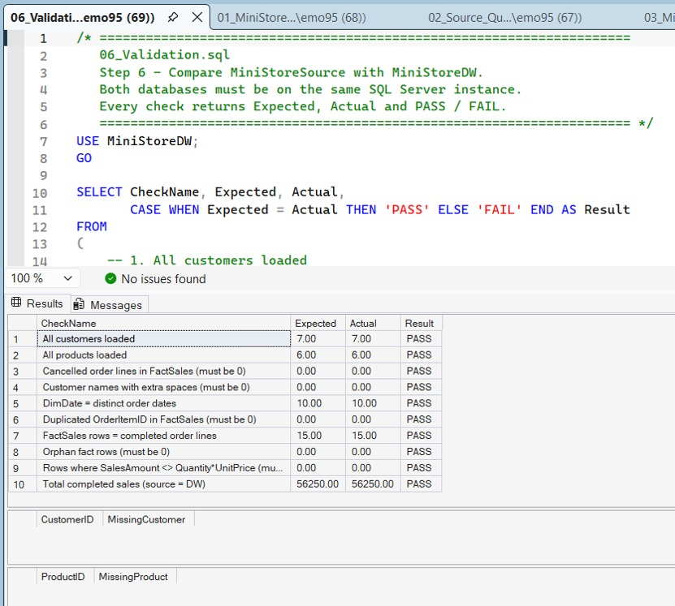

# MiniStore Data Warehouse – SQL Server + SSIS

An end-to-end ETL project that moves data from an operational online-store database into a star-schema data warehouse using **SQL Server Integration Services (SSIS)**, then validates the load and answers business questions with SQL.

Built as the final project of the Data Pill Data Engineering bootcamp.

## Architecture



## Star schema



**Grain of `FactSales`:** one row = one order line (one row of `OrderItems`).
`SalesAmount = Quantity × UnitPrice`.

## ETL design

The package runs five tasks in order:

1. **Clear DW tables** (Execute SQL Task) – deletes fact then dimensions and reseeds identities, so the package can be re-run safely.
2. **Load DimCustomer** – source query → Derived Column `LTRIM(RTRIM(CustomerName))` → destination.
3. **Load DimProduct** – source query → destination.
4. **Load DimDate** – distinct order dates with `DateKey` (YYYYMMDD), year, month and month name → destination.
5. **Load FactSales** – completed orders only → 3 Lookups (customer, product, date; *Fail component* on no match) → Derived Column `SalesAmount` → destination.

Design decisions:
- Dimensions load before the fact table so every lookup finds its key.
- Cancelled orders are filtered out in the source query (`OrderStatus = 'Completed'`), so revenue reports reflect completed sales only.
- Lookups fail the package instead of loading orphan fact rows.
- Surrogate keys are generated by the warehouse; source business keys are kept for traceability.

## Repository structure

```
MiniStore-DWH/
├── README.md
├── sql/
│   ├── 01_MiniStoreSource_Create_And_Load.sql
│   ├── 02_Source_Queries.sql
│   ├── 03_MiniStoreDW_Create.sql
│   ├── 05_DW_Reports.sql
│   └── 06_Validation.sql
├── ssis/
│   └── MiniStoreETL/          # Visual Studio SSIS project
└── docs/
    ├── MiniStore_Documentation.pdf
    └── screenshots/
```

## How to run

**Requirements:** SQL Server, SSMS, Visual Studio with the *SQL Server Integration Services Projects* extension.

1. In SSMS run `sql/01_MiniStoreSource_Create_And_Load.sql`, then `sql/03_MiniStoreDW_Create.sql`.
2. Open `ssis/MiniStoreETL/*.sln` in Visual Studio.
3. In the Connection Managers, point `MiniStoreSource` and `MiniStoreDW` to your SQL Server instance.
4. Run `LoadMiniStoreDW.dtsx` (F5). All five tasks should turn green.
5. Run `sql/05_DW_Reports.sql` for the reports and `sql/06_Validation.sql` for the checks.

## Results with the sample data

Source: 7 customers, 6 products, 10 orders (8 completed, 2 cancelled), 18 order lines.

| Table | Rows loaded |
| --- | --- |
| DimCustomer | 7 |
| DimProduct | 6 |
| DimDate | 10 |
| FactSales | 15 |

Total completed revenue: **56,250**. Top product: **Laptop (30,000)**.

### Validation

`06_Validation.sql` runs 10 checks comparing source and warehouse: row counts, no cancelled orders in the fact table, no orphan keys, no duplicated order lines, `SalesAmount = Quantity × UnitPrice`, trimmed customer names, and matching total sales. All 10 return **PASS**, including after re-running the package.

## Screenshots

| Control Flow | FactSales Data Flow |
| --- | --- |
|  |  |



## Tech stack

SQL Server · T-SQL · SSIS · Visual Studio · Dimensional modeling (star schema)

## Author

**Eman Mohamed Sobhy** – Communications & Electronics Engineering student, Benha University. Interested in Data Engineering, Data Analysis and AI/ML.
